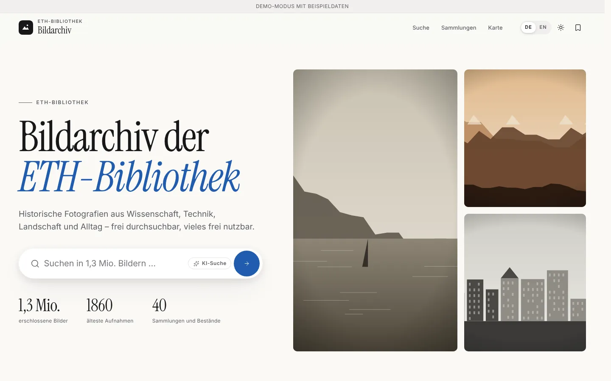
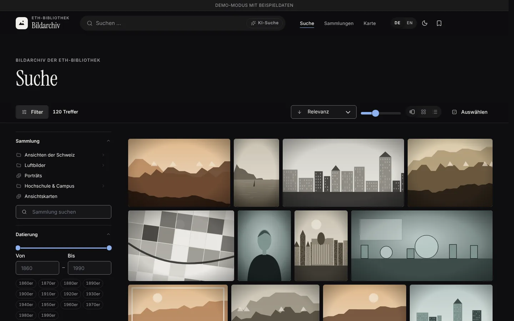
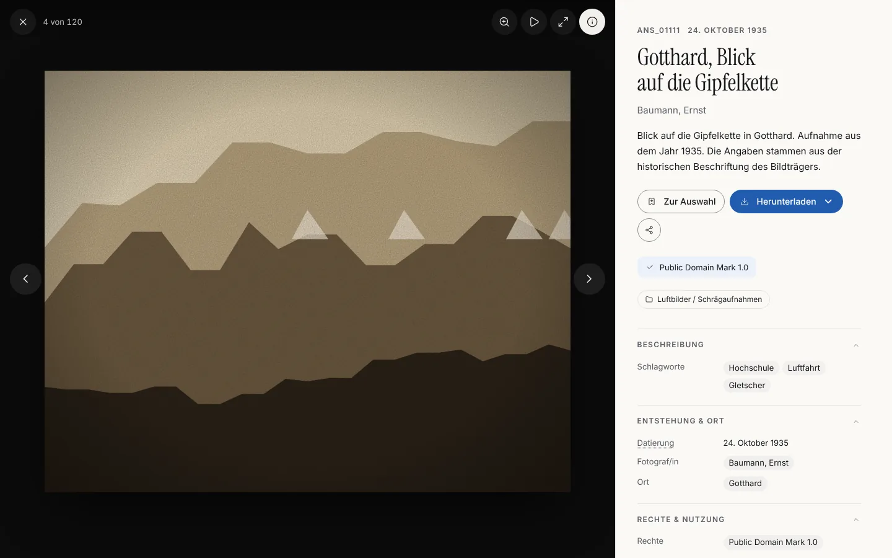
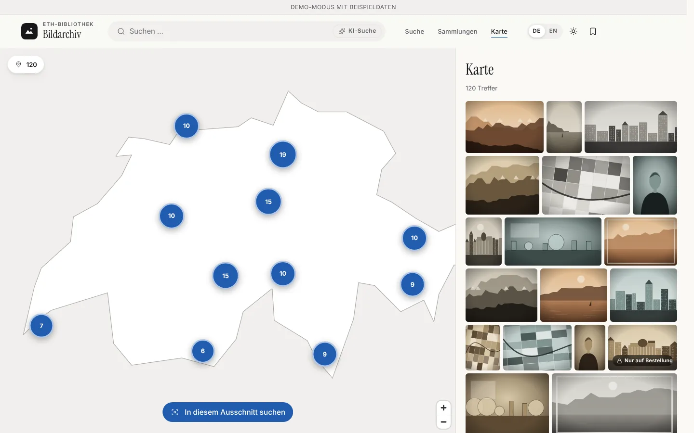

# Bildkatalog (E-Pics) – Neubau

Öffentlicher Bildkatalog als Web-Components-App: Suche, Filter, Sammlungen, Detailansicht mit
Deep Zoom, Download und Auswahl, Karte – direkt angebunden an die **Sharedien REST API (v13)**.
Neubau des bisherigen Frontends `ba.e-pics.ethz.ch` (brix:anura) mit gleichem Funktionsumfang und
neuem Design «Editorial Gallery». Kein Login, alles öffentlich.

> Es wurde kein Code der bisherigen anura-Komponenten übernommen (deren Lizenz verbietet das).
> Grundlage sind die Sharedien-API-Dokumentation und eine funktionale Analyse der alten App.

## Schnellstart

```bash
npm ci
npm run dev          # http://127.0.0.1:5173 – Demo-Modus mit Beispieldaten
```

Ohne `public/config/config.json` startet die App mit `config.example.json` im Demo-Modus: Die
Sharedien-Endpunkte werden im Browser nachgebildet, die Bilder sind generierte Platzhalter.

## Ansichten (Demo-Modus)

| Startseite                                           | Suche (dunkel)                                              |
| ---------------------------------------------------- | ----------------------------------------------------------- |
|  |  |
| **Detailansicht**                                    | **Karte**                                                   |
|   |                   |

Weitere: [Startseite dunkel](docs/screenshots/startseite-dunkel.webp),
[Suche hell](docs/screenshots/suche-hell.webp), [Sammlungen](docs/screenshots/sammlungen-dunkel.webp),
[Mobil](docs/screenshots/mobil-suche.webp).

## Funktionen

- **Suche**: Volltext mit Vorschlägen und Verlauf, UND/ODER, `"Phrase"`, optional KI-Suche
- **Filter**: Facetten mit Trefferzahlen, Zeitraum (Regler, Jahrzehnte), Textfelder mit
  Bedingung, Personen (Relationen), Sammlungen (Drill-down), «Filter hinzufügen», Chips
- **Treffer**: Galerie (Justified Grid), Raster, Liste; Sortierung; Bildgrösse; Nachladen beim
  Scrollen; Mehrfachauswahl mit Vergleich und CSV-Export
- **Detail**: Lightbox oder eigene Seite, Blättern (Tasten/Swipe), Diashow, Vollbild, Deep Zoom,
  gruppierte Metadaten mit Suchlinks, Lizenz, Sammlungspfade, verwandte Bilder, Downloads in
  allen Formaten (auch On-Demand), Bestellen, Teilen, Fehler melden
- **Auswahl**: Formate je Bild, ZIP-Download, Nutzungsbedingungen, teilen per Link, CSV
- **Karte**: Bildmarker und Cluster, Suche im Kartenausschnitt
- **Startseite und Sammlungen** mit Editorial-Layout
- **Hell/Dunkel/System**, Farbthemes per Config, DE/EN, Matomo, alte Deep Links
  (`#detail-asset=<id>`) werden weitergeleitet

Tastatur in der Detailansicht: ←/→ blättern, Esc schliessen, Z Zoom, F Vollbild, I Infospalte,
Leertaste Diashow.

## Technik

| Bereich      | Einsatz                                                                                       |
| ------------ | --------------------------------------------------------------------------------------------- |
| Komponenten  | [Lit 3](https://lit.dev) + TypeScript, eigene Elemente `ep-*`                                 |
| UI-Bausteine | [Web Awesome 3](https://webawesome.com) (MIT), Icons [Lucide](https://lucide.dev) (ISC) lokal |
| Zoom / Karte | OpenSeadragon, MapLibre GL – beide nur bei Bedarf geladen                                     |
| Build        | Vite, Validierung der Config mit Valibot                                                      |
| Tests        | Vitest (Logik), Playwright + axe (E2E, Barrierefreiheit)                                      |

```
src/
  config/       Schema, Vorgaben, Laden der config.json
  theme/        Farbableitung (OKLCH), Theme-Controller (Hell/Dunkel/System)
  i18n/         Texte DE/EN
  router/       History-Router, Weiterleitung alter anura-Links
  data/         Datenmodell, Sharedien-Client, Query-Builder, Demo-Mock
  state/        Such- und Auswahl-Store (URL = Suchzustand)
  components/   shell, home, search, filters, results, detail, basket, compare, collections, map
  features/     CSV-Export, Teilen/Download-Hilfen
```

## Konfiguration und Anbindung an Sharedien

Alle Einstellungen stehen in `public/config/config.json` (Laufzeit, kein Neu-Build nötig) –
Referenz: [docs/CONFIG.md](docs/CONFIG.md). Für den Betrieb:

1. `config.example.json` nach `config.json` kopieren, `api.mock: false` setzen.
2. `api.baseUrl` und den öffentlichen Gast-Token (`api.token`, ggf. `api.tokenUrl`) eintragen.
3. Feld-IDs unter `fields`, `filters`, `detail`, `results`, `export` an die Sharedien-Felder anpassen
   (Übersicht unter `<api>/swagger` bzw. `GET property-definitions`).
4. Bei Sharedien die Origin der App für CORS freischalten lassen.

## Skripte

| Befehl                            | Zweck                                                       |
| --------------------------------- | ----------------------------------------------------------- |
| `npm run dev`                     | Entwicklungsserver                                          |
| `npm run build`                   | Kontrastprüfung, Typprüfung, Produktions-Build nach `dist/` |
| `npm run preview`                 | Build lokal ausliefern                                      |
| `npm run lint` / `npm run format` | ESLint und Prettier                                         |
| `npm test`                        | Unit-Tests                                                  |
| `npm run test:e2e`                | E2E-Tests (baut und startet die App selbst)                 |
| `npm run check:themes`            | WCAG-Kontraste aller Themes prüfen                          |

## Betrieb

- **Docker / Cloud Run**: `docker build -t bildkatalog .` – nginx auf Port 8080 mit SPA-Fallback und
  Cache-Headern ([deploy/nginx.conf](deploy/nginx.conf)). `config.json` pro Umgebung nach
  `/usr/share/nginx/html/config/config.json` mounten.
- **Statisches Hosting**: Inhalt von `dist/` ausliefern; alle unbekannten Pfade müssen auf
  `index.html` zeigen (saubere URLs wie `/suche`, `/bild/<id>`).

## Lizenzen der Abhängigkeiten

Lit (BSD-3), Web Awesome Free (MIT), Lucide (ISC), OpenSeadragon (BSD-3), MapLibre GL (BSD-3),
Valibot (MIT), Schriften Inter und Instrument Serif (SIL OFL 1.1).
